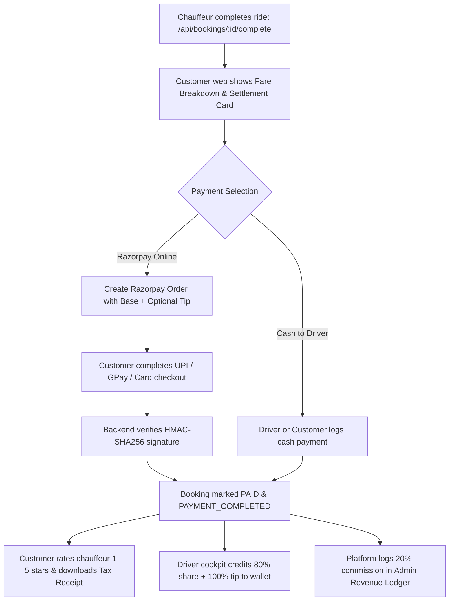

# DriverDost — Razorpay Payment Gateway Integration Guide

This guide walks through configuring and activating **Razorpay Online Payments** for the DriverDost on-demand chauffeur platform.

---

## 5-Step Razorpay Onboarding Walkthrough

Follow these 5 steps to complete your merchant verification and connect live settlements to your bank account:

### Step 1: Create a Razorpay Account
1. Visit [razorpay.com](https://razorpay.com) and click **Sign Up**.
2. Enter your work email or mobile number and verify via OTP.
3. Provide your Business / Brand Name (e.g., `DriverDost Technologies`) and your website link (`https://driverdost.com` or your live domain).

### Step 2: Choose Business Type & Enter PAN
1. Select your registered legal business type:
   - **Individual / Freelancer** (simplest for solo founders/pilots)
   - **Sole Proprietorship** or **Private Limited**
2. Enter your Personal PAN / Business PAN.
3. Razorpay's smart form auto-fetches most tax and identity details directly from the Income Tax database.

### Step 3: Complete KYC (Know Your Customer)
1. Verify the auto-filled identity details against your PAN.
2. Confirm your registered residential / business address with Aadhaar or Passport OTP.
3. Upload your business category (e.g., *Transportation & Logistics / Chauffeur Services*).

### Step 4: Set Up Payment Channels & Bank Details
1. **Payment Channels**: Enable **Website & Mobile App Checkout** (UPI, Credit/Debit Cards, Net Banking, and Wallets).
2. **Bank Account Details**: Provide your Account Holder Name, Bank Account Number, and IFSC code.
3. Razorpay conducts a 1-rupee penny-drop verification to ensure automatic T+1 daily settlement payouts directly into your account.

### Step 5: Submit for Approval & Generate API Keys
1. Submit your completed application for Razorpay risk operations review (instant for sandbox, typically 1–2 business days for live payments).
2. Once activated, navigate to **Razorpay Dashboard &rarr; Settings &rarr; API Keys**.
3. Click **Generate Key**:
   - `Key ID` (e.g., `rzp_live_...` or `rzp_test_...`)
   - `Key Secret` (keep confidential, stored only on server)
4. Add these keys to your DriverDost deployment (via `.env` or the **Admin Command Center**).

---

## Configuring Keys in DriverDost

### Method A: Via Admin Portal (Zero-Restart)
1. Open the Admin Command Center: [http://localhost:4000/admin](http://localhost:4000/admin)
2. Scroll to the **Razorpay Payment Gateway & Live Settlement Ledger** section.
3. Paste your `Key ID` and `Key Secret`, then click **Save Gateway Settings**.
4. The platform dynamically switches from Test Sandbox mode to Live Production mode without restarting the server.

### Method B: Via `.env` File
Create or update `driverdost-mvp/.env`:
```env
PORT=4000
RAZORPAY_KEY_ID=rzp_live_your_key_id_here
RAZORPAY_KEY_SECRET=your_key_secret_here
```

---

## Payment Lifecycle in DriverDost



---

## Testing Without Live Keys (Built-In Sandbox Simulator)

The MVP comes with a built-in **Interactive Razorpay Checkout Simulator**. When running in test mode:
1. Customer clicks **"Pay with Razorpay"**.
2. If Razorpay live credentials are not yet supplied, an interactive test checkout dialog opens with Google Pay, PhonePe, Cards, and Net Banking.
3. Clicking **"Authorize & Pay"** triggers a real HMAC/sandbox verification cycle, updating the ride to **PAID**, showing the digital tax receipt, and logging the transaction in the Admin Ledger.
